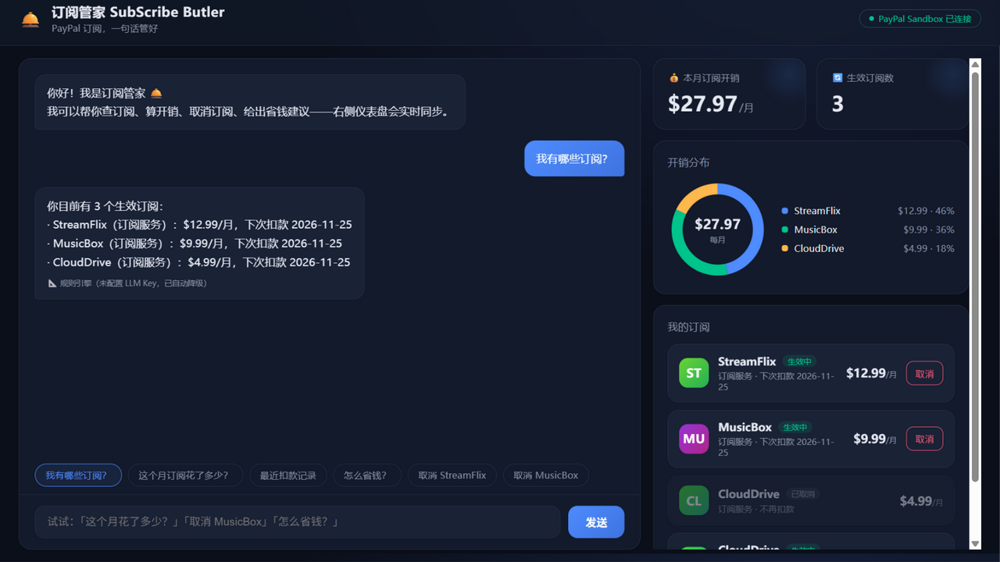

# 🛎️ SubScribe Butler — Manage PayPal Subscriptions by Chat

> **PayPal AI Hackathon entry** — an AI agent that manages your PayPal subscriptions in plain language: check spending, cancel anytime, get smart saving tips.



## ✨ What it does

- 💬 **Natural-language agent** — say *"how much did I spend this month?"*, *"cancel MusicBox"* or *"how can I save money?"* The agent understands the intent, calls PayPal APIs via function calling, and executes.
- 🔐 **Official PayPal integration** — OAuth2 client-credentials, the Subscriptions API (list / cancel) and the Transactions API (spend aggregation), running against the **PayPal Sandbox**.
- 📊 **Live dashboard** — monthly spend, spending distribution donut, subscription cards with one-click cancel; everything syncs in real time with the conversation.
- 🧪 **Zero-config demo mode** — with no credentials configured, the app runs on realistic mock data with a rule-based engine, so judges can try it in under a minute.
- 🛡 **Demo-proof resilience** — a background refresh loop keeps data warm; the dashboard reads a cache and responds in milliseconds even when PayPal is slow, and never whitescreens on network hiccups.

## 🚀 Quick start

```bash
pip install -r requirements.txt
uvicorn app.main:app --reload     # open http://127.0.0.1:8000
python smoke_test.py              # offline smoke test (mock mode, no credentials needed)
```

No configuration required for the first run — the app starts in **mock mode**.

## 🔑 Configuration (optional)

Copy `.env.example` to `.env`:

| Variable | Purpose |
|---|---|
| `PAYPAL_CLIENT_ID` / `PAYPAL_CLIENT_SECRET` | PayPal Developer **Sandbox** app credentials → [create one here](https://developer.paypal.com/dashboard/applications/sandbox). With these set, the app runs against the real PayPal Sandbox. |
| `PAYPAL_API_BASE` | Defaults to `https://api-m.sandbox.paypal.com` |
| `LLM_API_KEY` / `LLM_BASE_URL` / `LLM_MODEL` | Any OpenAI-compatible endpoint. Without a key, a built-in rule engine takes over — the demo never breaks. |

Don't want to sign up? Seeded demo data can be reproduced with `python seed_sandbox.py` (creates three sample subscriptions in your own sandbox).

## 🧩 PayPal APIs used

| API | Endpoint | Purpose |
|---|---|---|
| OAuth 2.0 | `POST /v1/oauth2/token` | Client-credentials access token |
| Subscriptions | `GET /v1/billing/subscriptions` | List subscriptions |
| Subscriptions | `GET /v1/billing/subscriptions/{id}` | Detail (plan, billing info, status) |
| Subscriptions | `POST /v1/billing/subscriptions/{id}/cancel` | Cancel a subscription |
| Catalog | `GET /v1/catalogs/products`, `GET /v1/billing/plans` | Resolve names & prices |
| Transactions | `GET /v1/reporting/transactions` | Debit history & spend stats |

## 🏗 Architecture

```
static/index.html      Chat + dashboard front-end (vanilla JS, SVG donut)
app/main.py            FastAPI service (+ background cache refresh loop)
app/agent.py           Agent: LLM function-calling loop → rule-engine fallback
app/paypal_client.py   PayPal REST client: sandbox / mock dual mode, cache-aside
app/mock_data.py       Realistic demo data for zero-config runs
seed_sandbox.py        Seeds three sample subscriptions into your sandbox
verify_paypal.py       Sandbox connectivity check (masks credentials)
```

## 📦 Deploy

See [DEPLOY.md](DEPLOY.md) — one-click on Railway (a `Dockerfile` and `Procfile` are included). The mock fallback means a public demo URL works even without any environment variables.

## 🗺 Roadmap

- [ ] Idle-subscription detection from real transaction history
- [ ] Pre-debit reminders (3 days before renewal)
- [ ] Multi-currency support
- [x] Live sandbox integration & seeded demo data

---

*Built for the PayPal AI Hackathon. All data shown in the demo runs against PayPal's sandbox (fake money) or local mock data — no real charges are involved.*
